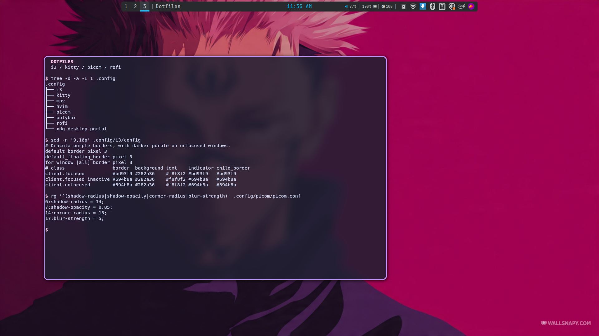
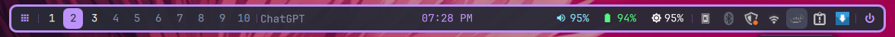
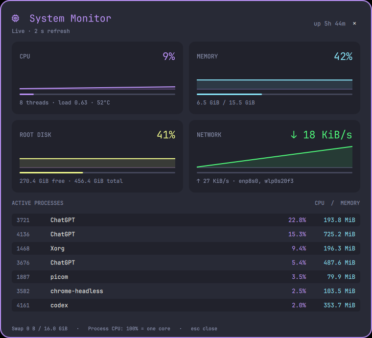
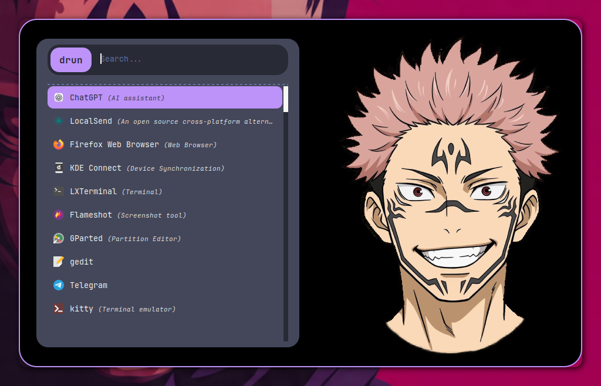
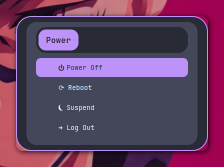
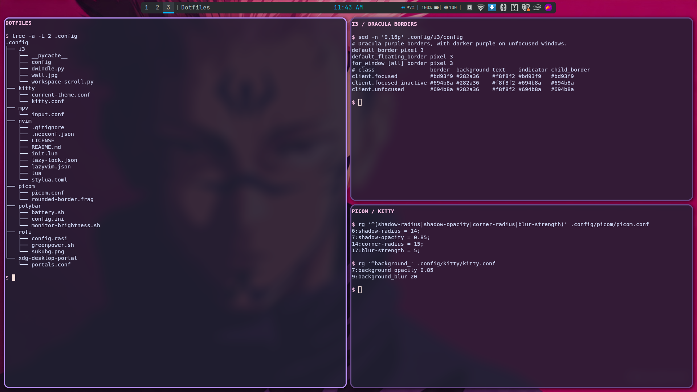

# Dotfiles

<!-- SPDX-License-Identifier: GPL-3.0-or-later -->

My Linux/X11 desktop, built around i3 and managed with GNU Stow.



## Polybar fallback

Workspaces, window title, clock, volume, battery, brightness, and system tray.


## Quickshell

The default i3/X11 bar auto-hides and slides down when the cursor reaches the
top 4 pixels of a screen. It lingers for at least 5 seconds after the cursor
leaves. The bar and i3's reserved space animate together over 320 ms; tiled
windows reclaim all space once it is hidden. It uses Dracula purple, rounded
corners, and JetBrains Mono Nerd Font. Includes ten workspace buttons, the focused window
title, date/time, live PipeWire audio, battery, brightness, and a system tray.
The system monitor shows live CPU, GPU/VRAM, RAM, disk, network, hardware
temperatures, and process statistics. The application button opens the existing
Rofi launcher.



Run with `nixGL quickshell`. See the [Quickshell setup notes](docs/setup.md#quickshell)
for dependencies, the legacy tray bridge, and switching back to Polybar.

## System monitor



## Rofi launcher and power menu

| Application launcher | Power menu |
| --- | --- |
|  |  |

<details>
<summary>Dwindle tiling preview</summary>



</details>

<details>
<summary>Animated lockscreen preview</summary>


| Idle ball | While typing a password |
| --- | --- |
|  |  |

The ball keeps spinning inside the native typing ring. These shader previews
show the idle and simulated typing states.

</details>

## What's included

- **i3:** dwindle autotiling, gaps, and rounded purple borders.
- **Picom + kitty:** animated tile resizing with upstream Picom 13, blur, shadows, and Catppuccin Mocha terminal colors.
- **Lockscreen:** a Superman shield on a spinning purple ball animated by Picom, with native i3lock authentication.
- **Rofi:** default application launcher and a power menu with confirmation prompts.
- **Polybar:** a fallback bar with audio and brightness controls.
- **Quickshell:** a floating bar and live resource monitor sharing the desktop's Dracula palette.

Neovim/LazyVim, Bash, mpv, and desktop-portal settings are also included.

## Setup

```sh
git clone https://github.com/thanvirdiouf/i3-stow.git "$HOME/.dotfiles"
cd "$HOME/.dotfiles"
```

Follow the [setup guide](docs/setup.md) for dependencies, Stow commands, and
machine-specific adjustments. Stow links configurations; it does not install apps.

## Essential shortcuts

| Shortcut | Action |
| --- | --- |
| `Super+Enter` | Open kitty |
| `Super+A` / `Super+Backspace` | Rofi launcher / power menu |
| `Super+F12` | Quickshell system monitor |
| `Super+1`–`0` | Switch workspace |
| `Super+Shift+D` | Toggle dwindle autotiling |
| `Super+L` | Lock the screen |
| `Print` / `Shift+Print` | Full-desktop / area screenshot |
| `Super+Shift+C` | Reload i3 |

More bindings are in the [i3 config](.config/i3/config).

## License

[](COPYING.md)

Original code, configuration, and documentation: **GPL-3.0-or-later**
([COPYING.md](COPYING.md)). Bundled third-party files retain their own licenses.
