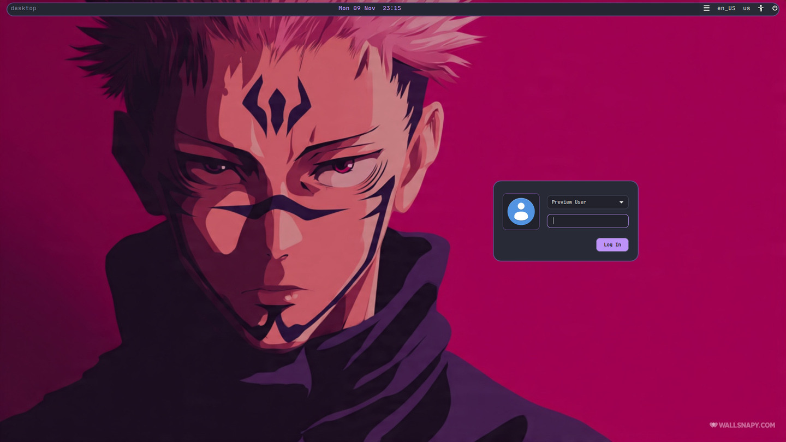

# LightDM login theme

<!-- SPDX-License-Identifier: GPL-3.0-or-later -->

The theme uses LightDM GTK Greeter with the Dracula palette from
[Quickshell](../.config/quickshell/Theme.qml), JetBrains Mono Nerd Font, and the
same wallpaper as i3 and bspwm. The login card sits to the right of the
wallpaper portrait. The panel carries the clock and the greeter's native
session, language, keyboard layout, accessibility, and power controls.



The preview uses the installed GTK greeter with a mock LightDM daemon. The
session menu and simulated password error were checked in that environment.

## Install on Linux Mint 22.3

Check that `lightdm --show-config` lists
`greeter-session=lightdm-gtk-greeter`. The theme uses the GTK 3 Adwaita dark
base and the desktop's `ePapirus-Dark` icons and `Bibata-Modern-Ice` cursor.
Install those icon and cursor themes system-wide if needed, or select installed
alternatives in [the drop-in](../system/lightdm/99_z-dotfiles.conf).

From the repository root, copy the theme and assets into system directories
readable by the greeter. Run the same commands after editing the theme.

```sh
src=system/lightdm
theme=/usr/local/share/themes/Dotfiles-LightDM
sudo install -D -m 0644 -T "$src/Dotfiles-LightDM/index.theme" "$theme/index.theme" &&
sudo install -D -m 0644 -T "$src/Dotfiles-LightDM/gtk-3.0/gtk.css" "$theme/gtk-3.0/gtk.css" &&
sudo install -D -m 0644 -T .config/i3/wall.jpg /usr/local/share/backgrounds/dotfiles-lightdm/wall.jpg &&
sudo install -D -m 0644 -T .local/share/fonts/JetBrainsMono/JetBrainsMonoNerdFont-Regular.ttf \
  /usr/local/share/fonts/dotfiles-lightdm/JetBrainsMonoNerdFont-Regular.ttf &&
sudo fc-cache -f /usr/local/share/fonts/dotfiles-lightdm &&
sudo install -D -m 0644 -T "$src/99_z-dotfiles.conf" \
  /etc/lightdm/lightdm-gtk-greeter.conf.d/99_z-dotfiles.conf
```

The drop-in loads after Mint's `99_linuxmint.conf`. Active keys in
`/etc/lightdm/lightdm-gtk-greeter.conf` load last, so check that file for
overrides if the theme does not appear. The theme uses the existing LightDM
seat configuration, including its i3 default and HDMI setup.
[GTK greeter configuration loading](https://github.com/Xubuntu/lightdm-gtk-greeter/blob/lightdm-gtk-greeter-2.0.9/src/greeterconfiguration.c)

Save your work and log out to see the greeter. Check the wallpaper, password
field, and session menu, then sign back in. Greeter diagnostics on this
machine are in `/var/log/lightdm/seat0-greeter.log`.

## Customize

Edit [the GTK stylesheet](../system/lightdm/Dotfiles-LightDM/gtk-3.0/gtk.css)
for colors, spacing, and focus styles. Edit
[the drop-in](../system/lightdm/99_z-dotfiles.conf) for the wallpaper path,
clock, indicators, or login card placement. Use
`position=50%,center 50%,center` for a centered card.

## Roll back

Remove the drop-in and start a fresh greeter to restore the previous appearance.
If necessary, switch to a text console with `Ctrl+Alt+F3` and sign in there.

```sh
sudo rm -- /etc/lightdm/lightdm-gtk-greeter.conf.d/99_z-dotfiles.conf
```

If the greeter is stuck and your work is saved, restart it from the text
console with `sudo systemctl restart lightdm`. Restarting LightDM ends
graphical sessions. For a full removal, delete the theme, wallpaper, and font
copies from the dedicated directories listed in the install commands.
